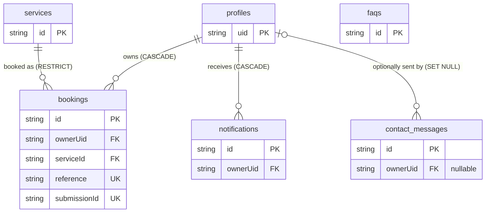

# Architecture

## Layers (package `za.co.giantautoupholstery`)
| Package | Contents |
|---|---|
| `core` | `Validation` (single source of truth), `BookingRules` (upcoming/past), `Formatting` (rand, references), `Time` (Africa/Johannesburg), `Errors`, `BusinessInfo`, `core.ui` (theme + shared composables) |
| `domain` | Models and repository contracts (`AuthRepository`, `BookingRepository`, …) — no Android/Room types |
| `data` | Room entities/DAOs/database, mappers, `CatalogSeeder`, `DevFixtures`, repository implementations, `FirebaseAuthRepository`, `OsNotifier`, DataStore settings |
| `di` | Hilt modules (database, Firebase, clock, bindings) |
| `ui` | `AppViewModel`, navigation (`AppRoot`, `Routes`) and feature packages (`auth`, `home`, `services`, `bookings`, `notifications`, `profile`, `support`) each with ViewModel + composables |

Flow: Composable → ViewModel (StateFlow) → repository interface → Room DAO (Flow) / Firebase. Business and validation logic never lives in composables.
Repositories are the only data-access entry point; every private DAO query takes the **verified Firebase UID**.

## Navigation and guards
Single `MainActivity` + Navigation Compose. Bottom bar: Home · Services · Bookings · Profile. Services, details, Help, About, Contact work as guest.
Bookings, New booking, Booking details, Notifications and Settings are wrapped in `Guarded`: guests see a sign-in prompt, the intended route is
stored in `SavedStateHandle` (`pending_route`, survives process death) and resumed after sign-in. Unknown/stale routes land on a "Page not found" screen.
Email/password accounts are an app session only after the email is verified (`AuthState.PendingVerification` otherwise).

## Entity-relationship diagram

## Data dictionary (SQLite via Room, DB `giant_auto_upholstery.db`, version 1)
**profiles** — `uid` TEXT PK (Firebase UID) · `fullName` TEXT · `phone` TEXT? · `address` TEXT? · `emailNotifications` INTEGER(bool) · `pushNotifications` INTEGER(bool) · `themeMode` TEXT (`system|light|dark`) · `createdAt`/`updatedAt` INTEGER (epoch ms UTC). *No passwords or hashes.*
**services** — `id` TEXT PK (UUID) · `name` · `category` (Sofa/Leather/Chairs/Auto) · `priceCents` INTEGER (rand cents) · `duration` TEXT · `description` TEXT · `createdAt` INTEGER · `imageRef` TEXT?
**bookings** — `id` PK · `ownerUid` FK→profiles · `reference` TEXT UNIQUE (`GAU-XXXXXX`) · `serviceId` FK→services · `preferredDate` TEXT ISO `yyyy-MM-dd` (Johannesburg calendar date) · `preferredTime` TEXT `HH:mm` (08:00–16:00) · `address` TEXT · `description` TEXT? · `status` TEXT (Pending/Confirmed/Completed/Cancelled) · `submissionId` TEXT UNIQUE (idempotency) · `createdAt` INTEGER. Indices: ownerUid, serviceId, status, (ownerUid, preferredDate), unique reference, unique submissionId.
**notifications** — `id` PK · `ownerUid` FK · `title` · `body` · `isRead` INTEGER(bool) · `createdAt` INTEGER. Indices: ownerUid, (ownerUid, isRead).
**faqs** — `id` PK · `question` · `answer` · `displayOrder` INTEGER.
**contact_messages** — `id` PK · `ownerUid` FK? · `name` · `email` · `subject` · `message` · `createdAt` INTEGER.

## Transactions and integrity
* Booking create = validate → (inside one Room transaction) idempotency lookup → service/profile existence → unique reference with collision retry → insert booking → insert notification. Any exception rolls back everything. Success is shown only after commit.
* Cancel = owner + `status='Pending'` re-checked atomically (`UPDATE … WHERE id AND ownerUid AND status='Pending'` must change exactly 1 row) + notification, one transaction.
* First sign-in: `INSERT IGNORE` profile; **only if inserted** one welcome notification is added (same transaction) → never duplicated.
* No customer action confirms/completes bookings or edits the catalogue (no such DAO calls are reachable from repositories).

## Migrations
Version 1 is the baseline, so no migration exists yet; `Migrations.ALL` is empty and **`fallbackToDestructiveMigration()` is deliberately not used**.
Schemas export to `app/schemas/` (committed, and added to `androidTest` assets). For every version bump: add a `Migration(n, n+1)`, export the schema, and add a `MigrationTestHelper` test.

## Security model and limits
* Firebase Authentication hashes/stores passwords; the app never stores passwords or hashes (SQLite, DataStore, logs). Passwords exist only in ViewModel memory, never in saved state. TLS via the Firebase SDK; Google SSO via Credential Manager (no WebView).
* Backup disabled (`allowBackup=false`, data-extraction rules exclude everything).
* **Device-local SQLite is not a server authorization boundary.** UID scoping is a client-side isolation measure and is not tamper-proof on rooted/modified devices. Logout clears navigation/VM state; the previous account's rows remain privately on the device and reappear only for that same UID.
* No secrets are embedded: `google-services.json` is git-ignored/CI secret; no keystore is committed.
